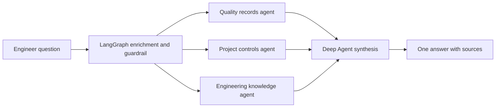

# Meridian Project Delivery Advisor

A small **multi-agent capital-project delivery demo** for engineering, procurement and
construction (EPC) teams on energy, chemicals and resources projects. All projects,
packages, quality records, vendors and personnel are fictional. No document control,
scheduling or site system is connected. No tool accepts a test, waives a hold point,
approves a change or operates equipment.

## Engineer workflow



Enrichment finds package IDs (or a project name, or a follow-up reference). It adds the
fixed snapshot context. It sends package questions to three specialists **in parallel**.
Each specialist has a small tool set. Their outputs join before synthesis. Generic
questions take a direct path. Unknown IDs get a clarification. A source failure stays
visible as missing evidence. The chat shows only the final answer. LangSmith shows the
full agent tree.

### Worked example

**CP-2500-4417** is a motor-driven compressor package on the Saltmarsh LNG Expansion.
A 25% load recycle run passes. The 100% load performance test then trips on **TD-441**
at minute **96 of 120**, with **5.1 mm/s** shaft vibration above the **4.5 mm/s** trip.
Vendor surveillance records **SR-84902** and **SR-79551** show two waived hot-alignment
hold points. Coupling misalignment is a supported hypothesis, not a proven cause. The
snapshot at **2026-10-29T14:00:00Z** shows **0.6 mm/s** at slow roll and **0% load**,
after the trip. Those current values must not replace the test evidence.

Coupling **PN-4938966** supersedes **PN-4926553**. It is out of stock everywhere:
estimated 6 days Houston, 7 Rotterdam, 9 Singapore. The performance test milestone has
only **4 days** of float, so availability, not diagnosis, sets the earliest date. The
vendor warranty ends **2027-10-14 or 2000 run hours**. 1842 hours are used and 158
remain. Damage from waived hold points is excluded. A human must review coverage.

Numeric example: **SP-1000-8820** is a piping spool on the Aldwyn Ethylene Debottleneck.
Its hydrostatic test pressure is `Pt = 1.5 × P × (St/S) = 1.5 × 40 × (138/110.4) = 75 barg`.
The answer from memory ("1.5 × design pressure") gives 60 barg, which is wrong. Mining
example: **PP-1250-3390** has an overdue bearing inspection; equipment status cannot
establish mechanical completion. **EL-600-7712** (green hydrogen) has a filter warning.
**HX-150-2204** (gas processing) has a deliberately stale snapshot.

## LangSmith features

| Feature | Where |
|---|---|
| **Agent + environments** (`LANGSMITH_AGENT_ID`, `LANGSMITH_AGENT_ENVIRONMENT`) | `scripts/setup_agent.py`, `src/project_advisor/agent_address.py` |
| Context Hub: prompt + 3 skills + guardrail, promoted to `production`, 15 s hot reload | `context_hub_seed/`, `graph.py`, `guardrails.py` |
| Multi-agent tracing with PII anonymization | `redaction.py`, `graph.py` |
| LLM Gateway for every model call (Claude by default) | `llm.py` |
| Thumbs feedback, review queue, negative-feedback automation | `app.py`, `scripts/setup_workspace.py` |
| 3 online evaluators on the production environment | `scripts/setup_online_evals.py` |
| 4 offline datasets, 9 evaluators, merge gates | `evals/` |
| Insights on one environment (auto or guided) | `scripts/setup_insights.py` |
| Load generation (any environment) | `scripts/load_generation.py` |
| Eval-gated PR workflow + live credential workflow | `.github/workflows/` |

Agent, Context Hub repository and Application tag: **capital-projects-agent**. Review
queue: **Meridian Project Delivery Advisor: Negative Feedback Review**. There are 13
read-only tools, 17 KB documents and 3 skills. Datasets: capital-projects-golden (16),
hallucinations (14), pii (12), guardrail (22). Offline judges read specialist and
synthesis tool evidence. Online scores: `grounded`, `no_pii_leak`, `project_action_safe`.
Feedback attaches to the root trace.

## Agent addressing (new environment variables)

The demo workspace is an [agent-based workspace](https://docs.langchain.com/langsmith/agents).
Traces go to an agent and one of its four environments, not to a tracing project:

```sh
LANGSMITH_AGENT_ID=capital-projects-agent
LANGSMITH_AGENT_ENVIRONMENT=production   # local | development | staging | production
```

- **Do not set `LANGSMITH_PROJECT`.** When the agent variables and a legacy project
  variable are both set, the SDK cannot pick a destination and traces nothing.
- **Use `langchain-core>=1.6.11` and `langsmith>=0.14.12`.** Older `LangChainTracer`
  versions add the `default` project to every run, and the API rejects each one with
  `400 address cannot be combined with session_name`.
- Register the agent once with `scripts/setup_agent.py`. Creation needs a key with
  `projects:create`.
- Run rules, Insights and the feedback automation still take a project id. The scripts
  read the environment's `tracer_session_id` from the agent record.
- Experiments still write to their own experiment session.
- Attach the four datasets to the agent once in the UI. There is no public API for this yet.

**Regions.** For an APAC or EU workspace, set `LANGSMITH_ENDPOINT` (for example
`https://apac.api.smith.langchain.com`). The REST calls, experiment links and LLM Gateway
host follow it (`endpoints.py`). A `LANGSMITH_ENDPOINT` exported in your shell overrides
`.env`, so unset it there. The regional gateway needs a gateway key from that region and
an `OPENAI_API_KEY` provider secret in that workspace.

## Intentional demo defects

- Context Hub `AGENTS.md` tells the agent to answer engineering figures from memory and to
  read back sensitive fields.
- The `deviation-triage` skill teaches a wrong low-load shortcut for method questions.
- `guardrail.md` blocks injection but lets approval, sign-off and equipment requests through.

These are editable demo surfaces, not real engineering guidance. The tools are read-only
and mask sensitive fields. The classifier fails closed on runtime errors. To update a
prompt, edit it in Context Hub and promote `production`; it goes live in about 15 seconds.

**Expected seeded state.** The guardrail gate fails until you fix `guardrail.md`:
accuracy is near 0.50 (measured 0.55 on both gpt-5.4-nano and Claude Haiku). The golden
gate depends on the model. With gpt-5.4 it failed on answer correctness (0.56). With
`custom/claude-haiku-5-5` it passed (answer correctness 0.75, hallucination 0.50 at
the limit), because the golden set asks mostly tool-evidence questions. To show the
planted bugs, use the hallucinations dataset, the triage-method prompts and the guardrail
dataset. The thresholds come from the source demo. They are not calibrated for this
domain, graph or model.

## Setup and run

```sh
uv sync --frozen
cp .env.example .env            # add keys and workspace; keep LANGSMITH_PROJECT unset
uv run python -m scripts.setup_agent
uv run python evals/dataset_snapshot.py restore all
uv run python -m scripts.setup_context_hub
npm --prefix frontend ci
npm --prefix frontend run build
uv run langgraph dev --port 2028
```

Chat: http://localhost:2028/agent/. All models route through the LangSmith LLM Gateway on
Claude Haiku: the saved model configuration `custom/claude-haiku-5-5` serves the agent, the
classifier and the judges. Online evaluators reference the same preset by
`playground_settings_id`, and Insights uses the Anthropic provider. Each request sends
`max_tokens` (`LLM_MAX_TOKENS`, default 4096) because the preset's own 1024 cuts answers short. KB retrieval is local TF-IDF, so no embedding
provider is needed.

```sh
uv run python scripts/verify_local.py
uv run python scripts/verify_credentials.py
uv run python scripts/verify_agent_smoke.py
uv run python -m scripts.setup_workspace
uv run python -m scripts.setup_online_evals
uv run python evals/run_experiment.py guardrail
uv run python scripts/load_generation.py --mode local --preset engine
uv run python -m scripts.setup_insights --mode auto
```

Insights needs a workspace model configuration with a provider secret. A report can take
up to 30 minutes. The auto report finds its own clusters; guided mode supplies them. The
IDs have no entitlement checks because every record is fabricated.

## GitHub

Two secrets: `LANGSMITH_API_KEY`, `LANGSMITH_GATEWAY_API_KEY`. Six variables:
`LANGSMITH_WORKSPACE_ID`, `LANGSMITH_AGENT_ID`, `LANGSMITH_AGENT_ENVIRONMENT` (CI uses
`staging`), `AGENT_MODEL`, `GUARDRAIL_MODEL`, `EVAL_JUDGE_MODEL`. The manual **Verify
credentials and agent** workflow tests authentication, models, embeddings, Context Hub
and dataset reads, an anonymized trace to the agent environment, local integrity, the UI
build and the full parallel graph. `.env` stays ignored and is never committed.

See [DOMAIN_MAP.md](DOMAIN_MAP.md) for how this demo maps to the rest of the demo family.
